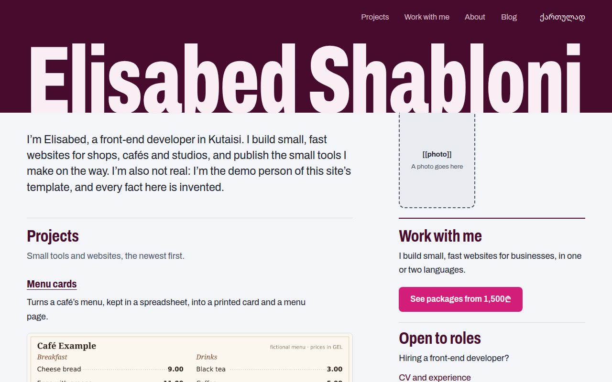
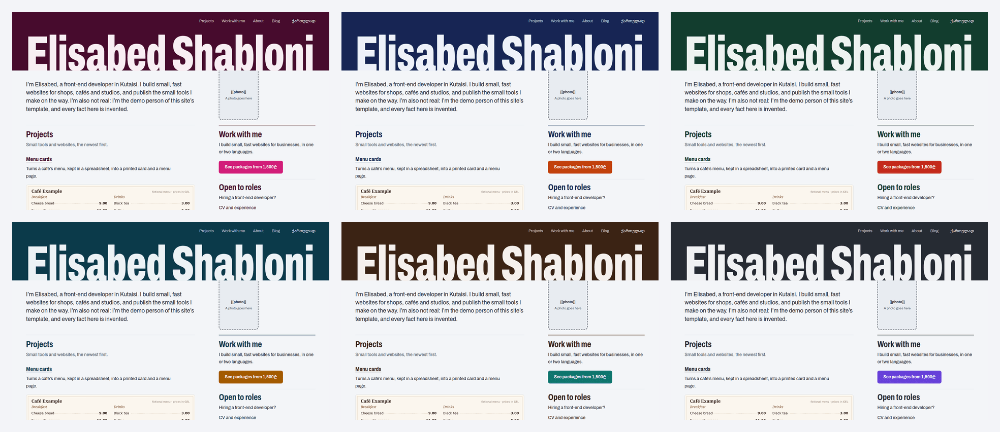

# sitewright

An agent skill that makes you a site of your own and takes it live. You answer a few questions in your agent; it builds the site from this repository's template, writes the texts with you, and takes the site live on Vercel, under your domain if you have one. Nothing on the site is invented, and nothing goes public without your yes.



The full description, with what it does not do: https://tsirbiladze.com/skills/sitewright

## Install

```bash
npx skills@latest add tsirbiladze/sitewright
```

Then ask your agent: "Make me a personal site."

It runs in agents that read the open Agent Skills format and can run commands. It was tried in Claude Code and in Codex.

## What you need

Node.js 24, pnpm, git and the GitHub CLI on your machine, a GitHub account and a Vercel account. Signing in to both happens in your own browser.

## What it makes

A static Next.js site in the design of https://tsirbiladze.com: your name from margin to margin on a field of one deep colour, and one call to action a page.

| Section | What it holds | Optional |
|---|---|---|
| Home | Your name, a paragraph about you, your newest projects | no |
| Projects | A list and a page per project; an agent skill is shown from its own repository | yes |
| Work | What you offer, a price, how it goes, a button that writes you an email | yes |
| About | Who you are and your CV: roles, skills, links, a PDF | yes |
| Blog | Posts in Markdown, with a feed | yes |

One or two languages (Latin-script languages and Georgian), six palettes or two colours of your own, share images, a sitemap, `/llms.txt`, and its own instructions for agents, so that later you change the site by asking.



## How it goes

1. **Ask**: your name, what you do, languages, sections, projects, colours, a domain if you have one.
2. **Scaffold**: a script makes the site's folder, with a dashed box wherever a fact is still missing.
3. **Write**: the texts, from your own words; you read every page on your machine.
4. **Repository**, on your yes: a GitHub repository, private unless you ask otherwise.
5. **Live**, on your yes: public on Vercel, at an address ending in `vercel.app`.
6. **Domain**, on your yes: the skill prints the DNS records, you enter them at your registrar, it checks until the domain answers.
7. **Hand over**: what was made, and how to change it from now on.

## Limits

Vercel only (its free plan is for personal, non-commercial use). One person, not a company or a shop. One or two languages, in Latin letters or Georgian. You enter the DNS records yourself. The layout and the type are fixed; colours, sections and every word are yours. The page linked above has the full list.

## In this repository

| Path | What it is |
|---|---|
| `skills/sitewright/` | The skill as it is installed: `SKILL.md` (the seven steps), `answers.md`, `writing.md`, `live.md`, and `scripts/scaffold.mjs`, which makes a site's folder from a person's answers |
| `template/` | The site template: a complete project that builds and passes its own checks as it is. `README.md` there is the README of every site made from it; `TEMPLATE.md` describes the fictional demo person it ships with |
| `docs/` | The text of the skill's page on tsirbiladze.com, in English and Georgian |
| `tests/` | The scaffold's tests, and `tests/rehearsal/`: the whole skill run against stand-ins for GitHub and Vercel |
| `SPEC.md`, `AGENTS.md` | What the skill must do, and the rules for working on it |

## How it is tested

- The template: 253 unit tests, a build in every shape a site can take (one or two languages, each section off), and a QA script in a real browser: accessibility, overflow from 320 to 1280 px, the keyboard path, the name's fit for 17 names at 8 widths.
- The scaffold and the skill's pages: 107 tests, and a slower run that scaffolds three sites and installs, builds and tests each.
- Two trials by agents that had never seen the skill, in Claude Code and in Codex, against stand-ins for GitHub and Vercel. What they found is fixed in this release.
- One real run on 2026-11-17: a private GitHub repository, a Vercel project, the first go-live, a preview and the domain's DNS records, all deleted afterwards.

Not yet seen: a real domain becoming ready through `pnpm domain --check`, an agent other than those two, a machine other than Linux.

```bash
npm test                      # the scaffold and the skill's pages
npm run test:e2e              # scaffolds sites, installs, builds and tests them
cd template && pnpm install && pnpm test && pnpm typecheck && pnpm build
```

Every person in the demo, the examples and the tests is fictional.

## License

MIT
