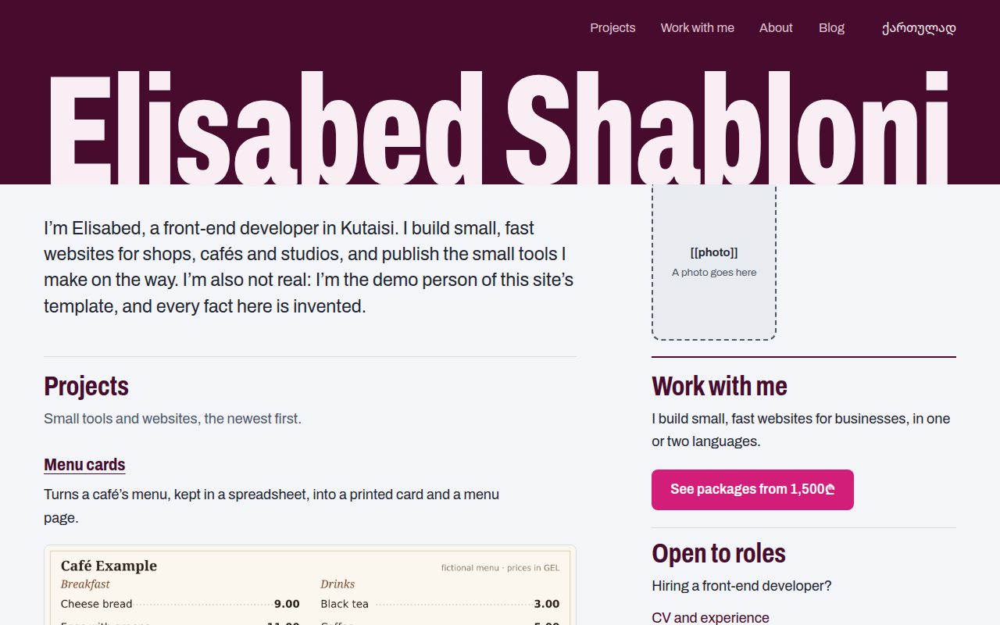
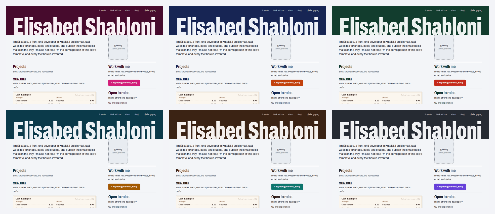

## რას აკეთებს

`sitewright` საკუთარ საიტს გიწყობს, ისე, როგორც ეს საიტია აწყობილი. აგენტს ეუბნები, ვინ ხარ და რას საქმიანობ. ის საიტს შაბლონიდან აწყობს, ტექსტებს შენთან ერთად წერს იმის მიხედვით, რაც უთხარი, და საიტს Vercel-ზე უშვებს, შენი დომენით, თუ გაქვს.

საიტზე არაფერია გამოგონილი. ფაქტი, რომელიც არ გითქვამს (ფასი, თარიღი, კლიენტის სახელი), გვერდზე წყვეტილ ჩარჩოდ რჩება, სანამ არ შეავსებ. შენი სიტყვის გარეშე არც არაფერი ხდება საჯარო: GitHub-ის რეპოზიტორია, გაშვება და დომენი ცალ-ცალკე ელოდება შენს თანხმობას.

როცა მზად არის, საიტი შენია. კოდი შენს GitHub-რეპოზიტორიაშია, საიტი შენს Vercel-ანგარიშზე მუშაობს, ტექსტები კი ჩვეულებრივი ფაილებია. საიტს საკუთარი ინსტრუქციებიც მოჰყვება, ამიტომ შემდეგ უკვე აგენტს სთხოვ: „დაწერე პოსტი ჩემს ბოლო პროექტზე“, „დაამატე ეს პროექტი“, „შეცვალე ფასი“.

## როდის გამოიყენო

აგენტს ჩვეულებრივი სიტყვებით სთხოვე: „გამიკეთე პირადი საიტი“, „პორტფოლიო მჭირდება“, „ჩემი CV ინტერნეტში დადე“. სკილი ერთი ადამიანის საიტისთვისაა. კომპანიის საიტს, მაღაზიას ან რამდენიმე ავტორის საიტს არ აწყობს.

| რა გინდა | რას იღებს საიტი |
|---|---|
| აჩვენო, რა გაგიკეთებია | პროექტების გვერდს და ცალკე გვერდს თითო პროექტისთვის. შენი აგენტის სკილი მისივე რეპოზიტორიიდან ჩანს, როგორც ამ საიტზე |
| კლიენტები | მომსახურების გვერდს: რას სთავაზობ, რა ღირს, როგორ მიდის საქმე, და ერთ ღილაკს, რომლითაც მოგწერენ |
| სამსახური | გვერდს შენ შესახებ, CV-ით: პოზიციები, უნარები, ბმულები და PDF, თუ გაქვს |
| წერა | ბლოგს Markdown-ში, RSS არხით |
| ორი ენა | ყოველ გვერდს ორივე ენაზე, ერთმანეთზე ბმულით |

ყოველი განყოფილება ირთვება და ითიშება. შეგიძლია მთავარი გვერდითა და CV-ით დაიწყო, ბლოგი კი მაშინ ჩართო, როცა სათქმელი გექნება.

## რას იღებ

- **ამ საიტის დიზაინს.** შენი სახელი კიდიდან კიდემდე დგას ერთი მუქი ფერის ველზე, ყოველ გვერდს კი ერთი მთავარი ღილაკი აქვს. სახელი სიგანეს აწყობისას ერგება: 6-დან 30 ასომდე, ლათინური ან ქართული ასოებით, ტელეფონიდან დიდ ეკრანამდე.
- **ექვს პალიტრას ან შენს ორ ფერს.** წყვილზე, რომელზეც ტექსტი ძნელად წასაკითხი იქნებოდა, უარს იღებ: სად და რა კონტრასტით.
- **მზადყოფნას ძებნის, გაზიარებისა და აგენტებისთვის.** საიტის რუკა, გასაზიარებელი სურათი ყოველი გვერდისთვის, RSS არხები, `/llms.txt` და ყოველი პროექტის გვერდის Markdown ვერსია.
- **შემოწმებებს, რომლებსაც თვითონ გაუშვებ.** `pnpm check` ჩამოთვლის ყველა ფაქტს, რომელიც ჯერ აკლია. ტესტები და QA სკრიპტი ამოწმებს მისაწვდომობას, ტელეფონის სიგანეზე გვერდიდან გასულ ელემენტებს, კლავიატურით მოძრაობას და სახელის მორგებას.
- **სამ ბრძანებას საჯარო ნაბიჯებისთვის.** `pnpm preview`, `pnpm go-live` და `pnpm domain` ჯერ შედეგს ამოწმებს და მერე გეუბნება. ის ორი, რომელიც ცვლის, რას ხედავს ხალხი, შენი თანხმობის გარეშე არ ეშვება.

## როგორ მიდის

1. **კითხვები.** შენი სახელი, რას საქმიანობ, ენები, რომელი განყოფილებები გინდა, პროექტები, ელფოსტა და დომენი, თუ გაქვს.
2. **აწყობა.** სკრიპტი შაბლონიდან ქმნის საიტის საქაღალდეს: შიგ არის ის, რაც თქვი, დანარჩენის ადგილას კი წყვეტილი ჩარჩოებია.
3. **ტექსტები.** თითო განყოფილება, შენივე სიტყვებიდან. ყოველ გვერდს ჯერ შენს კომპიუტერზე კითხულობ, მერე ხდება დანარჩენი.
4. **რეპოზიტორია.** *შენი თანხმობით.* კოდი შენს GitHub-რეპოზიტორიაში მიდის; დახურულში, თუ სხვას არ იტყვი.
5. **გაშვება.** *შენი თანხმობით.* საიტი Vercel-ზე საჯარო ხდება, მისამართით, რომელიც `vercel.app`-ით მთავრდება.
6. **დომენი.** *შენი თანხმობით.* სკილი შენს დომენს Vercel-პროექტს ამატებს და DNS-ჩანაწერებს გიჩვენებს. მათ შენ შეიყვან რეგისტრატორთან, სკილი კი ამოწმებს, სანამ დომენი HTTPS-ით არ უპასუხებს.
7. **გადაცემა.** მისამართი, რეპოზიტორია, რა დარჩა წყვეტილ ჩარჩოდ და როგორ შეცვალო საიტი ამის შემდეგ.

## როგორ მიხვდე, რომ სწორად მუშაობს

- საიტზე ყოველი წინადადება შენი ნათქვამია ან შენი დამტკიცებული. რაც არ გითქვამს, წყვეტილი ჩარჩოა და არა ვარაუდი.
- გკითხეს რეპოზიტორიის შექმნამდე, საიტის გაშვებამდე და დომენთან შეხებამდე.
- გაშვება მთავრდება სიტყვით `Live:` და მისამართით, მას შემდეგ, რაც საიტის ყოველმა გვერდმა იქ უპასუხა.
- `pnpm domain --check` მხოლოდ მაშინ ამბობს `Ready:`, როცა შენი დომენი HTTPS-ით პასუხობს. მანამდე გეუბნება, რა აკლია.
- ერთი კვირის შემდეგ, საიტის საქაღალდეში, თხოვნაზე „დაამატე პოსტი ჩემს მოგზაურობაზე“ წასაკითხ preview-ს იღებ და არა შეცვლილ საჯარო საიტს.

## შეზღუდვები

- **ჰოსტინგი**: მხოლოდ Vercel. Vercel-ის უფასო გეგმა პირადი, არაკომერციული გამოყენებისთვისაა, და საიტი, რომელიც ფასიან მომსახურებას სთავაზობს, [Vercel-ის პირობებით](https://vercel.com/legal/terms) შეიძლება კომერციულად ჩაითვალოს. სკილი ამას პირველ გაშვებამდე გეუბნება; გეგმას შენ ირჩევ.
- **ერთი ადამიანი.** არა კომპანიის საიტი, მაღაზია ან რამდენიმე ავტორის საიტი.
- **ენები**: ერთი ან ორი, ლათინური ან ქართული ასოებით. ინგლისურსა და ქართულს მენიუ და წარწერები მოჰყვება. სხვა ენისთვის მათ შენი აგენტი თარგმნის და შენ უნდა წაიკითხო. მარჯვნიდან მარცხნივ დამწერლობები არ მუშაობს.
- **DNS**: სკილი ჩანაწერებს გიჩვენებს და ამოწმებს. რეგისტრატორთან მათ შენ შეიყვან.
- **განლაგება და შრიფტი არ იცვლება.** ფერები, განყოფილებები და ყოველი სიტყვა შენია; დიზაინი არ გადაეწყობა.
- **შენს კომპიუტერზე** საჭიროა Node.js 24, pnpm, git, GitHub CLI და აგენტი, რომელსაც ბრძანებების გაშვება შეუძლია. GitHub-სა და Vercel-ზე შენს ბრაუზერში შედიხარ.
- **მოკლე და გრძელი სახელები.** 6 ასოზე მოკლე სახელი მარჯვენა კიდემდე არ აღწევს, 30-ზე გრძელი კი უფრო პატარა ზომით იწერება. `pnpm check` ამას გეუბნება.

რამდენად არის გამოცდილი: შაბლონს 252 ტესტი და QA სკრიპტი აქვს, საქაღალდის ამწყობ სკრიპტს, სკილის გვერდებთან ერთად, 109 ტესტი. ამ ვერსიის გამოსვლამდე მთელი გზა ორჯერ გაიარა აგენტმა, რომელსაც სკილი არასდროს ენახა: ერთხელ Claude Code-ში და ერთხელ Codex-ში, GitHub-ისა და Vercel-ის შემცვლელებთან. 2026 წლის 17 ნოემბერს ერთხელ ნამდვილადაც გაეშვა: დახურული რეპოზიტორია, Vercel-პროექტი, პირველი გაშვება, preview და დომენის DNS-ჩანაწერები; შემდეგ ყველაფერი წაიშალა. ჯერ არ შემოწმებულა: ნამდვილი დომენი, რომელიც `Ready:`-მდე მივიდა, სხვა აგენტები და Linux-ის გარდა სხვა სისტემა.

სადემო საიტსა და მაგალითებში ყველა ადამიანი გამოგონილია.
