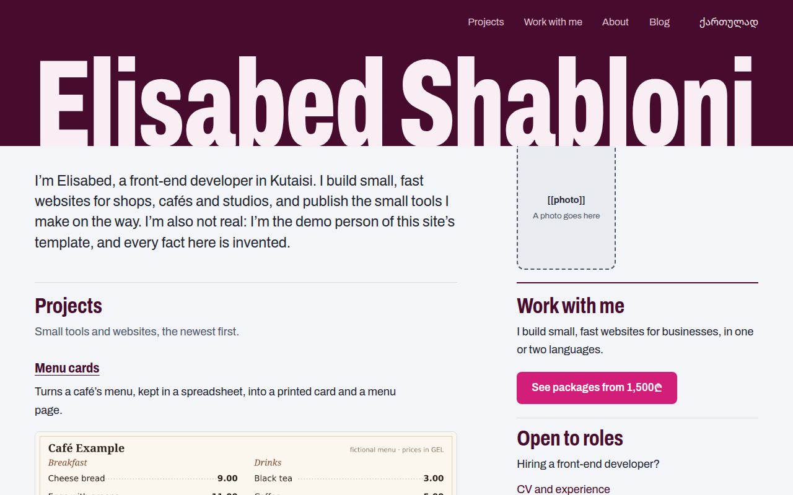
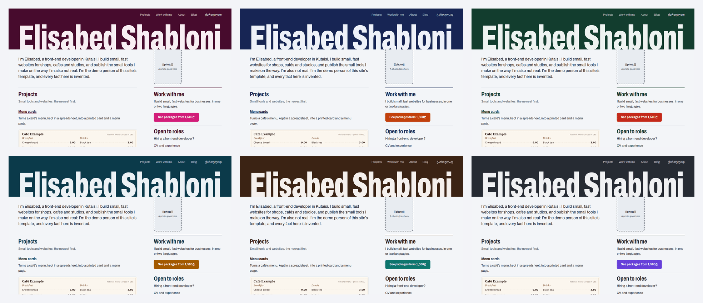

## What it does

`sitewright` makes you a site of your own, the way this one is made. You tell your agent who you are and what you do. It builds the site from a template, writes the texts with you from what you said, and takes the site live on Vercel, under your domain if you have one.

Nothing on the site is invented. A fact you have not given, a price, a date, a client's name, stays a dashed box on the page until you fill it. And nothing reaches other people without your word: the GitHub repository, going live and the domain each wait for your yes, one at a time.

When it is done the site is yours. Its code is in your GitHub repository, it runs in your Vercel account, and its words are plain files. It carries its own instructions too, so from then on you change it by asking an agent: "write a post about my last project", "add this project", "change the price".

## When to reach for it

Ask your agent in plain words: "make me a personal site", "I need a portfolio", "put my CV online". The skill is for one person's site. It is not for a company, a shop or a site with several authors.

| You want | The site gets |
|---|---|
| To show what you made | A projects page and a page for each project. An agent skill of yours is shown from its own repository, the way this site shows its skills |
| Clients | A work page: what you offer, the price, how it goes, and one button that writes you an email |
| A job | An About page with your CV: roles, skills, links, and the PDF if you have one |
| To write | A blog in Markdown, with a feed |
| Two languages | Each page in both, each linking to the other |

Every section is a switch. You can start with a home page and a CV, and turn the blog on the day you have something to say.

## What you get

- **The design of this site.** Your name runs from margin to margin on a field of one deep colour, and each page has one call to action. The name is fitted to its width at build time, for a name of 6 to 30 characters in Latin letters or Georgian, at every width from a phone to a desktop.
- **Six palettes, or two colours of your own.** A pair on which some text would be hard to read is refused, with the place and the contrast ratio.
- **Ready for search, sharing and agents.** A sitemap, a share image for every page, feeds, `/llms.txt`, and a Markdown twin of every project page.
- **Checks you can run.** `pnpm check` lists every fact still missing. Unit tests and a QA script cover accessibility, overflow at phone widths, the keyboard path and the name's fit.
- **Three commands for the public steps.** `pnpm preview`, `pnpm go-live` and `pnpm domain` each prove their result before they say it, and the two that change what the public sees refuse to run without your yes.

## How it goes

1. **Ask.** Your name, what you do, the languages, which sections you want, your projects, an email, a domain if you have one.
2. **Scaffold.** A script makes the site's folder from the template, with what you said in it and a dashed box for everything else.
3. **Write.** The texts, one section at a time, from your own words. You read every page on your own machine before anything else happens.
4. **Repository.** *Your yes.* The code goes to a GitHub repository of yours, private unless you ask otherwise.
5. **Live.** *Your yes.* The site becomes public on Vercel, at an address ending in `vercel.app`.
6. **Domain.** *Your yes.* The skill adds your domain to the Vercel project and prints the DNS records. You enter them at your registrar, and it checks until the domain answers over HTTPS.
7. **Hand over.** The address, the repository, what is still a dashed box, and how to change the site from now on.

## It's working if

- Every sentence on the site is one you said or approved, and what you did not say is a dashed box, not a guess.
- You were asked before the repository was created, before the site went live, and before the domain was touched.
- Going live ends with `Live:` and the address, after every page of the site answered there.
- `pnpm domain --check` says `Ready:` only when your domain answers over HTTPS. Until then it says what is missing.
- A week later, in the site's folder, "add a post about my trip" gets you a preview to read, not a changed live site.

## Limits

- **Hosting**: Vercel only. Vercel's free plan is for personal, non-commercial use, and a site that offers paid work may count as commercial in [Vercel's terms](https://vercel.com/legal/terms). The skill tells you this before the first deployment; the plan is your choice.
- **One person.** Not a company site, a shop, or a site with several authors.
- **Languages**: one or two, in Latin letters or Georgian. English and Georgian come with their menu and labels. For another language your agent translates them, and you should read them. No right-to-left scripts.
- **DNS**: the skill shows the records and checks them. Entering them at your registrar is yours to do.
- **The layout and the type are fixed.** Colours, sections and every word are yours; the design is not rearranged.
- **Your machine** needs Node.js 24, pnpm, git, the GitHub CLI, and an agent that can run commands. Signing in to GitHub and Vercel happens in your own browser.
- **Short and long names.** A name under 6 characters stops short of the right margin, and one over 30 is set smaller. `pnpm check` says so.

How far it is tested: the template has 262 unit tests and a QA script, and the script that makes your folder, with the skill's own pages, has 109 tests. Before this release the whole path was run twice by agents that had never seen the skill, in Claude Code and in Codex, against stand-ins for GitHub and Vercel. It was run once for real on 2026-11-17: a private repository, a Vercel project, the first go-live, a preview and the domain's DNS records, all deleted afterwards. Not yet seen: a real domain becoming `Ready:`, an agent other than those two, and a machine other than Linux.

All people on the demo site and in the examples are fictional.
